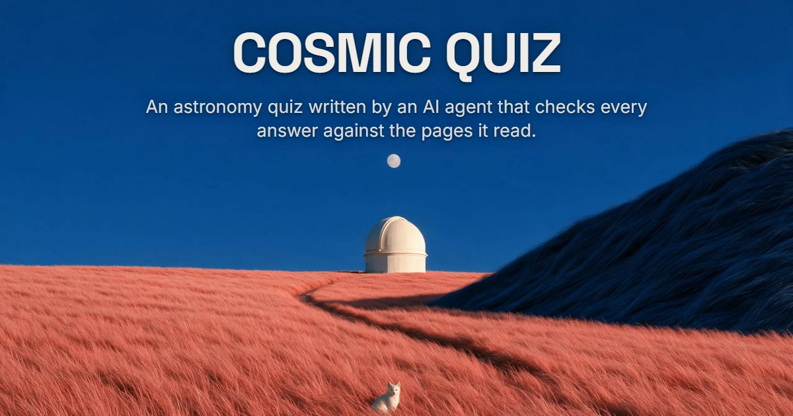
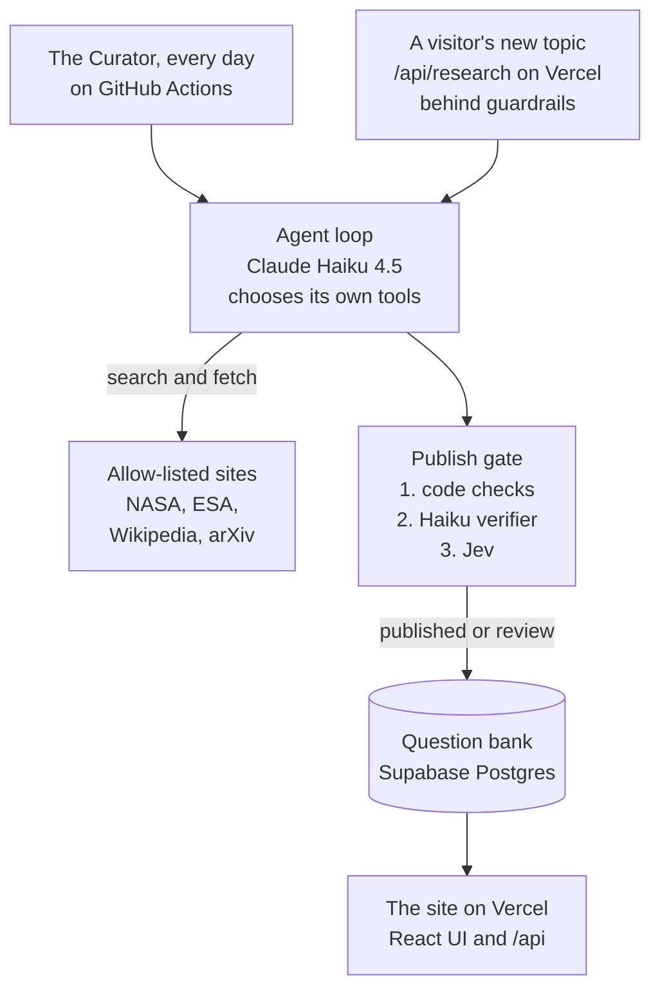
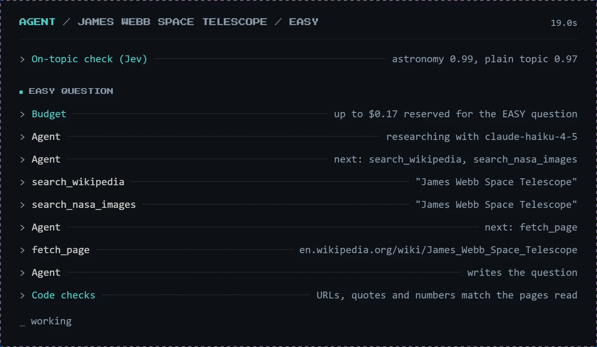
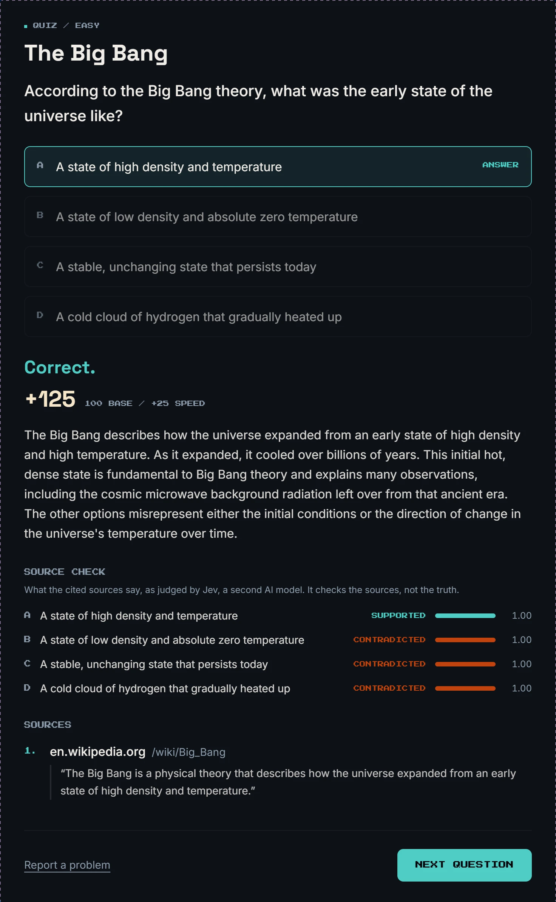
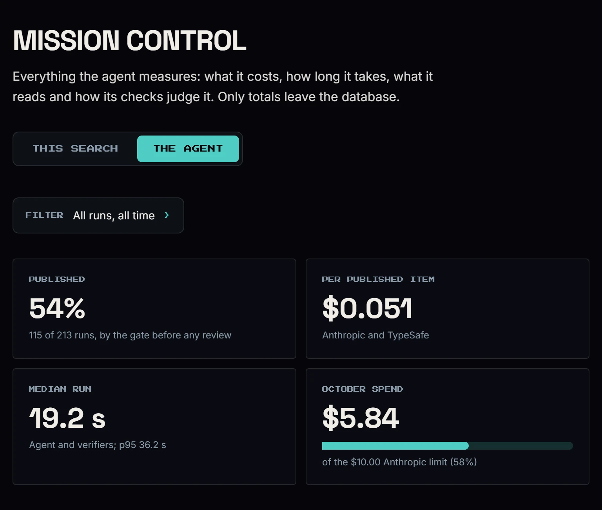

# Cosmic Quiz

An astronomy quiz written by an AI agent that checks every answer against the pages it read.

**Live:** [cosmic.vedantgaikwad.ie](https://cosmic.vedantgaikwad.ie)

- **It checks itself.** The agent may cite only pages it fetched in that run, a rule enforced in
  code rather than trusted to the prompt, and everything it writes passes three separate checks
  before a player sees it. In an eval with 40 planted faults, 38 never reached a player.
- **It runs on its own.** The model chooses its own tools in a hand-rolled loop, with no agent
  framework, and a scheduled job grows the question bank every day with no one pressing a button.
- **It is live, at a capped cost.** A visitor can watch it research a new topic, at about $0.12
  a search, under a $10 a month spend cap. Every model call's tokens and cost are logged, and the
  site shows them.

**Stack:** Python 3.12 with the Anthropic SDK and Pydantic; Claude Haiku 4.5; TypeSafe's Jev as
a second-opinion model; React, TypeScript, Tailwind CSS and Vite; Supabase Postgres; Vercel;
GitHub Actions.

Built by [Vedant Gaikwad](https://www.vedantgaikwad.ie). "I love astronomy, so I built the quiz
I wanted to play, and made the agent that writes it prove every answer."

## What you can do

- **Learn:** pick a topic for a plain-language explanation at one of three levels, with the
  pages it is based on.
- **Quiz:** runs of 10, 30 or 60 questions against the clock, each on a different topic. After
  each answer you see the explanation, the sources, and a source check: what a second model
  found in the cited pages for every option.
- **Try a new topic:** type any astronomy topic and the agent researches it live, streaming each
  step, including every claim it checks. Two searches a day per visitor.
- **Mission Control:** what the agent costs, how long it takes and how its checks judge it,
  from live data.
- Ranks, streaks and tiered trophies, kept in your browser.

## How it works

### The agent

- A hand-rolled tool-calling loop (`run_agent` in `agent/loop.py`, about 120 lines) behind a
  small provider interface (`agent/llm.py`). No agent framework. The model chooses the tools,
  and a budget of steps, time, tokens and cost bounds every run.
- Tools (`agent/tools/`): Wikipedia search, arXiv search, the NASA Image Library, APOD, NASA and
  ESA news feeds, and `fetch_page`, which reads only an allow-list of science sites. Every
  request, and every redirect, is checked against the allow-list before it is made.
- Every model output is validated with Pydantic.
- **The citation rule is enforced in code, not trusted to the prompt** (`agent/verify.py`): a
  source can only be a URL fetched in that run. Anything else is dropped.

A live search on the site, 19 seconds in: the on-topic check, the budget reserved for the run,
then the model choosing its own searches and pages, and the first of the checks. The whole
search, on "James Webb Space Telescope" on 13 October 2026, made all four items it set out to
make, in 86 seconds of agent and checks, for $0.097.

### The publish gate

Three layers, cheapest and most certain first:

1. **Code checks:** every cited URL was fetched in the run; every quote is word for word on its
   page; every number in the answer appears on a fetched page.
2. **Haiku verifier:** a separate Claude Haiku 4.5 pass, with its own prompt, confirms the quotes
   support the answer and that each wrong option is wrong.
3. **Jev second opinion:** TypeSafe's Jev checks each claim (the answer, each wrong option, each
   sentence of the explanation) against the full text of the cited pages, and answers supports,
   contradicts or says nothing, with a confidence. It cannot check numbers reliably, which is
   why layer 1 does.

An item is published only if all three pass: Jev must back the right answer at a confidence of
0.8 or more, and back no wrong option and contradict no sentence. Any doubt sends the item to
human review (`python -m curator review`); a failure discards it. Measured on a 60-item eval
with 40 planted faults ([`docs/EVALS.md`](docs/EVALS.md)):

| Fault planted | Kept from players |
|---|---|
| A wrong number | 10 of 10 |
| A quote that is not on the page | 10 of 10 |
| A claim the sources do not support | 8 of 10 |
| A wrong option rewritten to be true | 10 of 10 |
| **All** | **38 of 40** |

The two misses are planted sentences the sources arguably do support. The cost of that
strictness: on the live site, 115 of 213 runs (54%) published directly by 13 October 2026; 80
went to review and 17 were discarded.

What a player sees after answering: the explanation, Jev's verdict on every option, and the
quote each source was cited for.

  

### Live research, behind guardrails

- A cheap on-topic check first: two yes-or-no questions to Jev, with the typed text passed as
  data (44 of 44 labelled inputs right, about $0.00002 a check). It runs only after the limits
  below, so a refused search costs nothing.
- **Per visitor** (a salted hash of the IP address, never the address): 2 searches a day, 300
  API requests an hour, 10 reports a day.
- **For everyone:** 4 searches and $0.50 a day, $4 a month. Each run reserves the most it can
  cost ($0.17) until it ends, so the caps hold even when searches start at the same moment.
- Over a limit, the visitor keeps everything the bank already has.

## Cost

- One model for every step: Claude Haiku 4.5. Anthropic usage is capped at $10 a month by a
  Console spend limit. Jev runs on a prepaid TypeSafe balance ($0.042 per million input tokens).
  Everything else is on a free tier: Vercel Hobby, Supabase and GitHub Actions.
- Measured on the live site by 13 October 2026: 213 runs for $5.89, all checks included, which
  is about $0.028 a run and $0.051 for each item published directly. A median run takes 19.2 s
  (95% within 36.2 s), and prompt caching cut the agent's cost by about a quarter.
- A live search of four items costs about $0.12. The daily Curator, paid from 1 November, about
  $0.17, capped at $0.40.
- Every model call's tokens and cost are logged, and Mission Control shows them:

## Security and privacy

Audited before the repo went public ([`docs/SECURITY_AUDIT.md`](docs/SECURITY_AUDIT.md)): 19
findings, none High; the five Medium ones are fixed, each with a test, and every other finding is
recorded with what was done about it. The site sends a Content-Security-Policy that allows only
itself, the API refuses requests from other sites' pages, the browser-safe database key can read
only published items, and the git history was scanned for secrets.

No accounts, cookies, ads or tracking: progress stays in your browser. An IP address is never
stored; it becomes a salted hash, kept for about a day (30 days with a report). The full text is at
[/privacy](https://cosmic.vedantgaikwad.ie/privacy).

## Run it yourself

Setup, the checks and a map of the repository are in
[`docs/DEVELOPMENT.md`](docs/DEVELOPMENT.md). The checks run on every push (the badge above);
none of them calls a paid API.

## How it was built

Planned and built by Vedant Gaikwad in sessions with Claude Code. Each session's decisions,
checks and costs are recorded in [`docs/PLAN.md`](docs/PLAN.md), and the design record is
[`docs/DESIGN.md`](docs/DESIGN.md).

## Contact

For anything else, including questions about the project or requests for more details, please
use the [contact form on vedantgaikwad.ie](https://www.vedantgaikwad.ie/#contact).

## Licence

The code is under the [MIT License](LICENSE). The scene images, the link-preview image and the
screenshots in `docs/images/` are not: all rights are reserved. The fonts are under the SIL Open
Font License. Details are in [`NOTICE`](NOTICE).
