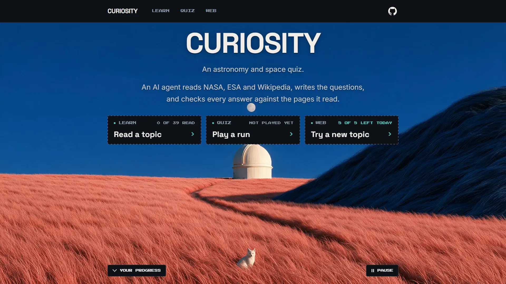
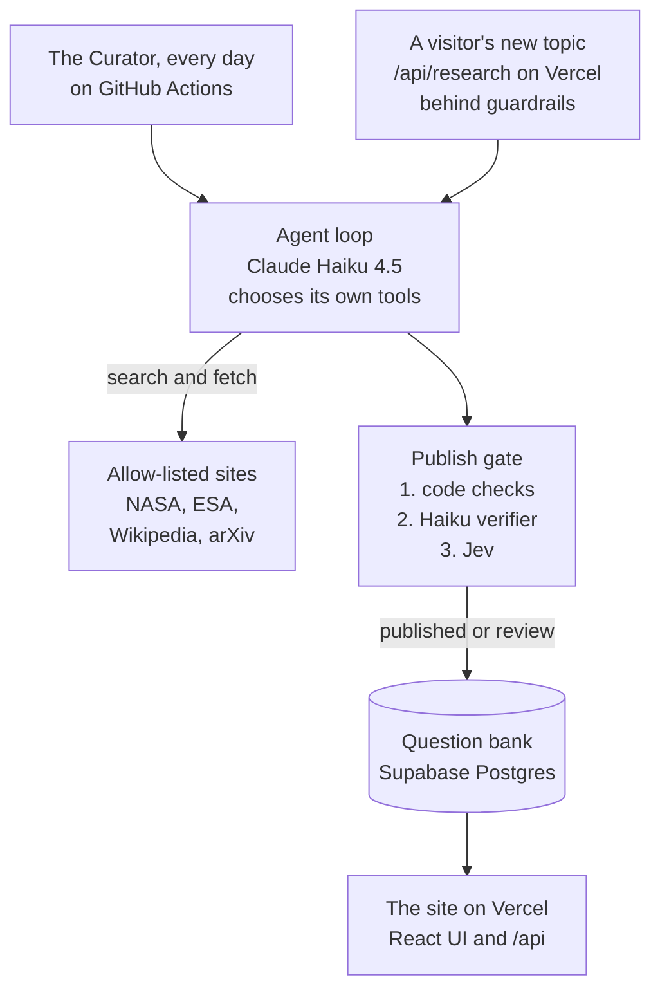
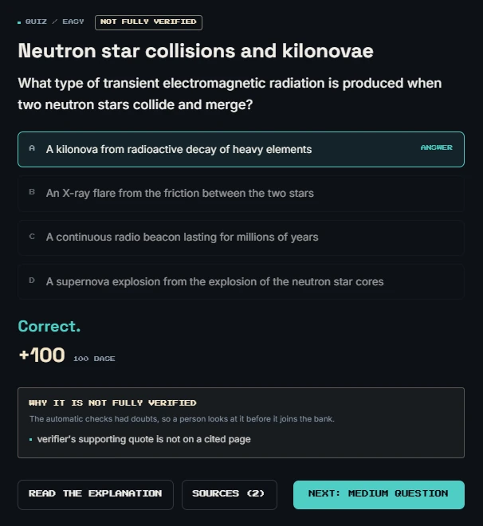
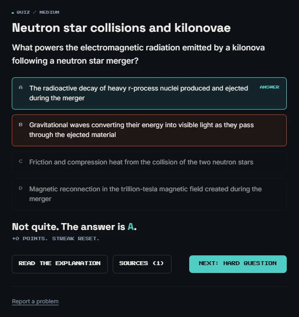
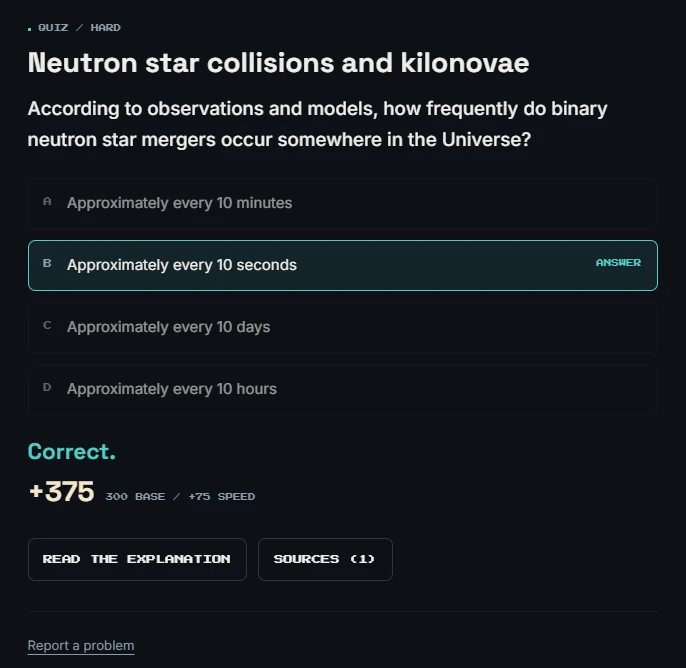
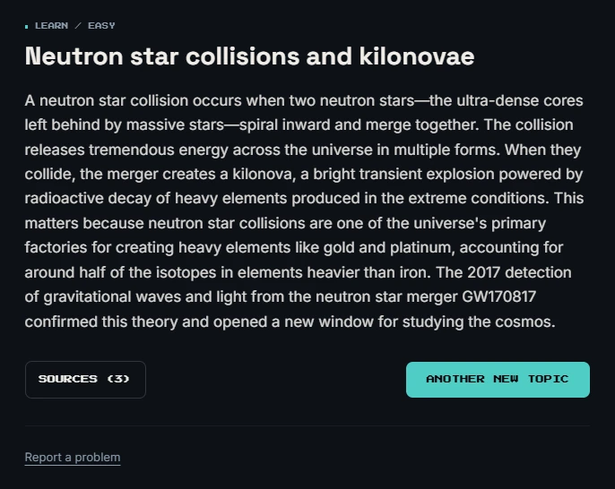
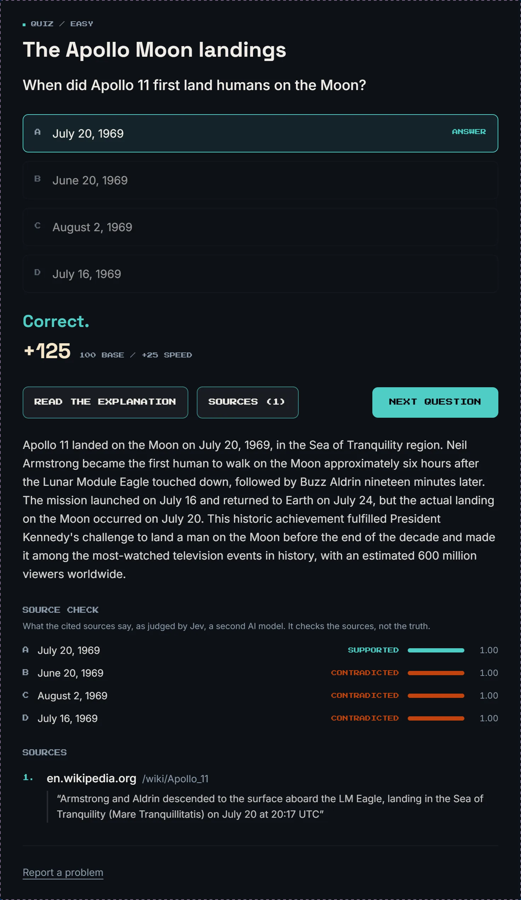
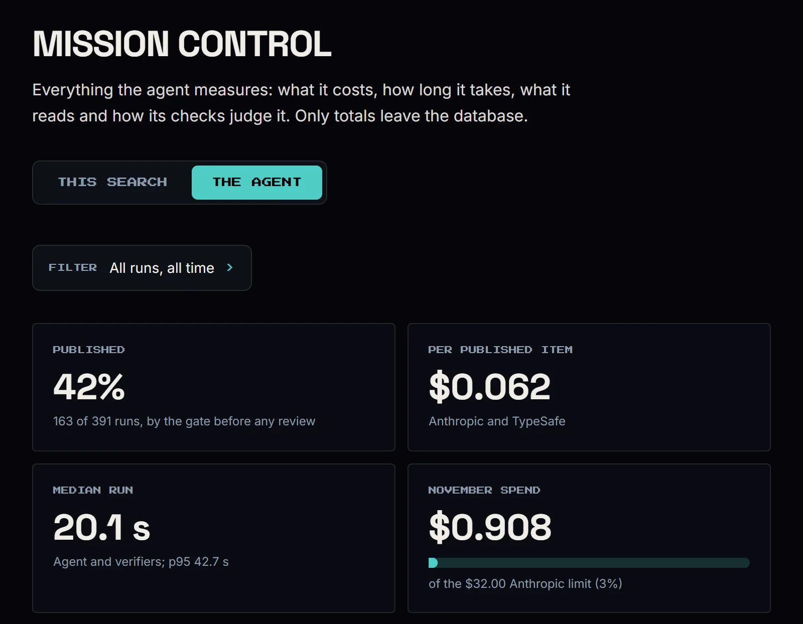

# Curiosity

An astronomy quiz written by an AI agent that checks every answer against the pages it read.

**Live:** [curiosity.vedantgaikwad.ie](https://curiosity.vedantgaikwad.ie)

- **It checks itself.** The agent may cite only pages it fetched in that run, a rule enforced in
  code rather than trusted to the prompt, and everything it writes passes three separate checks
  before a player sees it. In an eval with 40 planted faults, 38 never reached a player.
- **It runs on its own.** The model chooses its own tools in a hand-rolled loop, with no agent
  framework, and a scheduled job grows the question bank every day with no one pressing a button.
- **It is live, at a capped cost.** A visitor can watch it research a new topic, at about $0.17
  a search, under a $10 a month spend cap ($32 for November 2026, the launch month). Every model
  call's tokens and cost are logged, and the site shows them.

**Stack:** Python 3.12 with the Anthropic SDK and Pydantic; Claude Haiku 4.5; TypeSafe's Jev as
a second-opinion model; React, TypeScript, Tailwind CSS and Vite; Supabase Postgres; Vercel;
GitHub Actions.

Built by [Vedant Gaikwad](https://www.vedantgaikwad.ie). "I love astronomy, so I built the quiz
I wanted to play, and made the agent that writes it prove every answer."

The site was called Cosmic Quiz until 30 October 2026, when it was renamed after the Mars rover.
The repo keeps the name `cosmic-quiz-agent`.

## What you can do

- **Learn:** pick a topic for a plain-language explanation at one of three levels, with the
  pages it is based on. There are 39 topics today, each at its own address, and the ones you have
  read are marked.
- **Quiz:** runs of 10 or 30 questions against the clock, each on a different topic. A run of 60
  opens when the bank has that many topics at the level. After each answer you see right or wrong
  at once, then a row of buttons: "Read the explanation", "Sources (n)" (the cited pages and a
  source check: what a second model found in them for every option) and the next question. The
  two panels start closed and stay as you last left them.
- **Try a new topic:** type any astronomy topic, or press Surprise me, and the agent researches it
  live. The easy question arrives first and the other items after it. Three bars (Easy, Medium,
  Hard) and an explanations line follow the agent's real steps, and "Show details" opens the
  streamed log, including every claim it checks. A results card follows the last question, and
  then the explanations open. Two searches a day per visitor (five in the launch week, 3 to 9
  November 2026).
- **Mission Control:** what the agent costs, how long it takes and how its checks judge it,
  from live data.
- Ranks named after Mars rovers, from Sojourner to Perseverance, each with one fact and its source
  page in the code; streaks and tiered trophies. All of it is kept in your browser.

A sticky header on every page holds the navigation and that page's settings.

## How it works

### The agent

- A hand-rolled tool-calling loop (`run_agent` in `agent/loop.py`, about 120 lines) behind a
  small provider interface (`agent/llm.py`). No agent framework. The model chooses the tools,
  and a budget of steps, time, tokens and cost bounds every run.
- Tools (`agent/tools/`): Wikipedia search, arXiv search, the NASA Image Library, APOD, NASA and
  ESA news feeds, and `fetch_page`, which reads only an allow-list of science sites. Every
  request, and every redirect, is checked against the allow-list before it is made.
- Every model output is validated with Pydantic.
- **The citation rule is enforced in code, not trusted to the prompt** (`agent/verify.py`): a
  source can only be a URL fetched in that run. Anything else is dropped.

A live search makes up to six items, a question and an explanation at each level, each on a thread
of its own (`agent/ondemand.py`). The easy question goes first and alone, and the others start
together when it ends. If it fails with nothing spent, the others never start, so a refused API key
costs one model call, not six. The log tags each line with its item, so the lines of runs at once
interleave.

These pictures are from a real search on the launch day, 3 November 2026. "Neutron star collisions
and kilonovae" made all six items in 32.4 s for $0.1258. Four were published and two went to review.

<table>
  <tr>
    <td width="50%" valign="top"> Easy: the verifier had doubts, so the question is marked and shown only to the visitor who searched until a person reviews it.</td>
    <td width="50%" valign="top"> Medium: a wrong answer, with the right one marked and the next question ready.</td>
  </tr>
  <tr>
    <td width="50%" valign="top"> Hard: the answer comes from the sentence the question cites, on one arXiv page.</td>
    <td width="50%" valign="top"> An explanation, which opens once the questions are answered.</td>
  </tr>
</table>

### The publish gate

Three layers, cheapest and most certain first:

1. **Code checks:** every cited URL was fetched in the run; every quote is word for word on its
   page; every number in the answer appears on a fetched page.
2. **Haiku verifier:** a separate Claude Haiku 4.5 pass, with its own prompt, confirms the quotes
   support the answer and that each wrong option is wrong.
3. **Jev second opinion:** TypeSafe's Jev checks each claim (the answer, each wrong option, each
   sentence of the explanation) against the full text of the cited pages, and answers supports,
   contradicts or says nothing, with a confidence. It cannot check numbers reliably, which is
   why layer 1 does.

An item is published only if all three pass: Jev must back the right answer at a confidence of
0.8 or more, and back no wrong option and contradict no sentence. Any doubt sends the item to
human review (`python -m curator review`); a failure discards it. Measured on a 60-item eval
with 40 planted faults ([`docs/EVALS.md`](docs/EVALS.md)):

| Fault planted | Kept from players |
|---|---|
| A wrong number | 10 of 10 |
| A quote that is not on the page | 10 of 10 |
| A claim the sources do not support | 8 of 10 |
| A wrong option rewritten to be true | 10 of 10 |
| **All** | **38 of 40** |

The two misses are planted sentences the sources arguably do support. The cost of that
strictness: on the live site, 163 of 391 runs (42%) published directly by 3 November 2026; 166
went to review, 34 were discarded and 28 ended with no answer to check. A Jev check that ends in an
error also sends an item to review, and 70 of those runs had one. After human review the bank holds
295 published items.

What a player sees after answering, with both panels open: the explanation, Jev's verdict on every
option, and the quote each source was cited for.

  

### Live research, behind guardrails

- A cheap on-topic check first: two yes-or-no questions to Jev, with the typed text passed as
  data (44 of 44 labelled inputs right, about $0.00002 a check). It runs only after the limits
  below, so a refused search costs nothing.
- **Per visitor** (a salted hash of the IP address, never the address): 2 searches a day, 300
  API requests an hour, 10 reports a day.
- **For everyone:** 4 searches and $1.55 a day, $4 a month. Each run reserves the most it can
  cost ($0.17) until it ends, and a search reserves all its runs when it starts, up to $1.02, so
  the caps hold even when searches start at the same moment.
- **November 2026,** the launch month: $20 a month for live research, so the launch cannot use up
  the month in its first days.
- **Launch week** (the UTC days 3 to 9 November 2026): 5 searches a day per visitor, and 14
  searches and $3.25 a day for everyone. At about $0.17 a search, the whole week at full use
  costs about $17, inside November's $20. The dates are in code, so the usual limits come back
  by themselves, and the $4 month on 1 December.
- A search the model never answered is free: when every run of it fails with nothing spent, it
  does not count against the daily limits.
- Over a limit, the visitor keeps everything the bank already has.

How long a new topic takes:

| How the items run | Whole search | First question |
|---|---|---|
| One after another (measured 28 to 30 October 2026) | median 145.2 s, range 118.9 to 171.6 s (n=4) | not measured |
| All at once (from 1 November 2026) | 61.3 s (n=1) | 49 s (n=1) |
| Easy question first (since 2 November 2026) | 32.4 to 97.0 s (n=4; one of the searches made 5 items, not 6) | 14.1 to 41.2 s (n=4) |

About 20 s of the n=1 search looks like a one-time cost, inferred from timing: the first model call
after more than a day without a run took about 20 s. The site tells a visitor to expect the first
question in under a minute and the whole topic in a minute or two.

### The site

- `pnpm build` prerenders the home page, `/learn`, `/quiz`, `/explore` and one page for each
  complete Learn topic, each with its own title, description, canonical link, preview tags and
  text, so a crawler can read them with no script (`scripts/prerender/`). React takes over in the
  browser. The [sitemap](https://curiosity.vedantgaikwad.ie/sitemap.xml) lists 43 addresses today.
- The old address `cosmic.vedantgaikwad.ie`, six typo and short addresses (such as
  `curiousity.vedantgaikwad.ie` and `quiz.vedantgaikwad.ie`) and the `.vercel.app` address redirect
  permanently to the live site and keep the path. A misspelt path such as `/lern` goes to the
  nearest page (`src/closeMatch.ts`), and the 404 page suggests near matches.

## Cost

- One model for every step: Claude Haiku 4.5. Anthropic usage is capped at $10 a month by a
  Console spend limit, raised to $32 for November 2026 only: $20 for the launch month's live
  research, about $5 for the daily Curator, $5 to fill the bank with 30 likely topics, and $2
  spare. Jev runs on a prepaid TypeSafe balance ($0.042 per million input tokens).
  Everything else is on a free tier: Vercel Hobby, Supabase and GitHub Actions.
- Measured on the live site on 3 November 2026: 391 runs since 2 October for $10.05, all checks
  included, which is about $0.026 a run and $0.062 for each item published directly. A median run
  takes 20.1 s (95% within 42.7 s), and prompt caching has saved $2.87, about a quarter of what the
  agent would otherwise have cost.
- A live search of six items costs about $0.17, an estimate from what one item usually costs. The
  one all-at-once search measured above cost $0.20 (n=1), and the three six-item easy-first searches
  cost $0.1561, $0.1511 and $0.1258. The daily Curator, paid from 1 November, about $0.17, capped at
  $0.40.
- Every model call's tokens and cost are logged, and Mission Control shows them:

## Security and privacy

Audited before the repo went public ([`docs/SECURITY_AUDIT.md`](docs/SECURITY_AUDIT.md)): 19
findings, none High; the five Medium ones are fixed, each with a test, and every other finding is
recorded with what was done about it. The site sends a Content-Security-Policy that allows only
itself, plus connections to the project's Supabase address; the API refuses requests from other
sites' pages, the browser-safe database key can read only published items, and the git history was
scanned for secrets.

No accounts, cookies, ads or tracking: progress stays in your browser. An IP address is never
stored; it becomes a salted hash, kept for about a day (30 days with a report). The full text is at
[/privacy](https://curiosity.vedantgaikwad.ie/privacy).

## In the code, not on the site

Two things in this repo are not live, and `CLAUDE.md` and `docs/DESIGN.md` describe them as
decided work:

- **Optional sign-in** is off for the launch (the build flag `VITE_ACCOUNTS`), and its migration
  (011) is not applied.
- **Pictures on the Learn cards:** the pipeline is written, but its migration (012) is not applied
  and no image is uploaded, so a card shows the topic's name.

## Run it yourself

Setup, the checks and a map of the repository are in
[`docs/DEVELOPMENT.md`](docs/DEVELOPMENT.md). The checks run on every push (the badge above);
none of them calls a paid API.

## How it was built

Planned and built by Vedant Gaikwad in sessions with Claude Code. Each session's decisions,
checks and costs are recorded in [`docs/PLAN.md`](docs/PLAN.md), and the design record is
[`docs/DESIGN.md`](docs/DESIGN.md). What changed since the public release is in
[`CHANGELOG.md`](CHANGELOG.md).

## Contact

For anything else, including questions about the project or requests for more details, please
use the [contact form on vedantgaikwad.ie](https://www.vedantgaikwad.ie/#contact).

## Licence

The code is under the [MIT License](LICENSE). The scene images, the link-preview image and the
screenshots in `docs/images/` are not: all rights are reserved. The fonts are under the SIL Open
Font License. Details are in [`NOTICE`](NOTICE).
