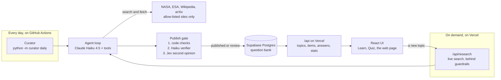

# Cosmic Quiz

An astronomy quiz written by an AI agent that checks every answer against the pages it read.

**Live:** [cosmic.vedantgaikwad.ie](https://cosmic.vedantgaikwad.ie)


Cosmic Quiz is a Learn and Quiz game about astronomy and space. Every explanation and question in
it was researched and written by an AI agent that reads NASA, ESA, Wikipedia and arXiv, may cite
only pages it actually fetched, and must pass three independent checks before anything reaches a
player. A scheduled job grows the question bank every day with no one pressing a button, and
visitors can ask the agent to research a new topic live and watch it work.

Built by [Vedant Gaikwad](https://www.vedantgaikwad.ie), a data analyst and full-stack developer
in Dublin.

## What you can do

- **Learn:** pick a topic for a plain-language explanation at one of three levels, with the
  pages it is based on.
- **Quiz:** runs of 10, 30 or 60 questions against the clock, each on a different topic. After
  each answer you see the explanation, the sources, and a source check: what a second model
  found in the cited pages for every option.
- **Try a new topic:** type any astronomy topic and the agent researches it live, streaming each
  step, including every claim it checks. Two searches a day per visitor.
- **Analytics for nerds:** what the agent costs, how long it takes and how its checks judge it,
  from live data.
- Ranks, streaks and tiered trophies, kept in your browser.

## How it works



### The agent

- A hand-rolled tool-calling loop of about 150 lines (`agent/loop.py`) behind a small provider
  interface (`agent/llm.py`). No agent framework. The model chooses the tools; a step budget
  bounds every run.
- Tools (`agent/tools/`): Wikipedia search, arXiv search, the NASA Image Library, APOD, NASA and
  ESA news feeds, and `fetch_page`, which reads only an allow-list of science sites. Every
  request, and every redirect, is checked against the allow-list before it is made.
- Every model output is validated with Pydantic.
- **The citation rule is enforced in code, not trusted to the prompt** (`agent/verify.py`): a
  source can only be a URL fetched in that run. Anything else is dropped.

### The publish gate

Three layers, cheapest and most certain first:

1. **Code checks:** every cited URL was fetched; every quote is word for word on its page; every
   number in the answer appears on a fetched page.
2. **Haiku verifier:** a separate Claude Haiku 4.5 pass, with its own prompt, confirms the quotes
   support the answer and that each wrong option is wrong.
3. **Jev second opinion:** TypeSafe's Jev checks each claim against its quoted passage and
   answers supports, contradicts or says nothing, with a confidence. It cannot check numbers
   reliably, which is why layer 1 does.

An item is published only if all three pass (Jev at 0.8 or above). Any doubt sends it to human
review (`python -m curator review`); a failure discards it. Measured on a 60-item eval with 40
planted faults ([`docs/EVALS.md`](docs/EVALS.md)):

| Fault planted | Kept from players |
|---|---|
| A wrong number | 10 of 10 |
| A quote that is not on the page | 10 of 10 |
| A claim the sources do not support | 8 of 10 |
| A wrong option rewritten to be true | 10 of 10 |
| **All** | **38 of 40** |

The cost of that strictness: 43% of generated items publish directly, and the rest go to review
or are discarded. The two misses are planted sentences the sources arguably do support.

### Live research, behind guardrails

- A cheap on-topic check first: two yes-or-no questions to Jev, with the typed text passed as
  data (44 of 44 labelled inputs right, about $0.00002 a check). It runs only after the limits
  below, so a refused search costs nothing.
- **Per visitor** (a salted hash of the IP address, never the address): 2 searches a day, 300
  API requests an hour, 10 reports a day.
- **For everyone:** 4 searches and $0.50 a day, $4 a month. Each run reserves the most it can
  cost ($0.17) until it ends, so the caps hold even when searches start at the same moment.
- Over a limit, the visitor keeps everything the bank already has.

## Cost

- One model for every step: Claude Haiku 4.5. Anthropic usage is capped at $10 a month by a
  Console spend limit. Jev runs on a prepaid TypeSafe balance ($0.042 per million input tokens).
  Everything else is on a free tier: Vercel Hobby, Supabase and GitHub Actions.
- Measured: about $0.024 an item in the eval (EASY $0.019, HARD $0.029), a live search of up to
  four items about $0.12, and the daily Curator about $0.17, capped at $0.40.
- Every model call's tokens and cost are logged, and Analytics for nerds shows them.

## Security

Audited before the repo went public ([`docs/SECURITY_AUDIT.md`](docs/SECURITY_AUDIT.md)): 19
findings, none High. The five Medium ones are fixed, each with a test.

- Security headers on every response, including a Content-Security-Policy that allows this site
  only. The fonts and images are served from the site itself.
- The API refuses requests that another site's page sends, and a POST must carry JSON.
- `fetch_page` checks every redirect against the allow-list before following it.
- Row-level security: the browser-safe key can read only published items, and even that key
  stays on the server. The secret key never reaches the browser.
- `agent_stats()`, the statistics behind Analytics for nerds, returns aggregates only. It is the
  one database function the browser-safe key may run; the site calls it through its own API.
- Secrets live only in environment variables. The git history was scanned with gitleaks before
  the repo went public.

## Privacy

The same text is on the site at [/privacy](https://cosmic.vedantgaikwad.ie/privacy).

- No accounts, no cookies, no ads and no tracking. Your progress stays in your browser.
- **In your browser:** your rank, points, trophies, the topics you have read and the questions
  you have seen are saved in local storage. The numbers of the questions you have seen are sent
  with each request for a new one, so you are not shown them again; the server does not keep
  them.
- **On the server:** your IP address is turned into a visitor code, a salted hash (for IPv6, of
  the address's first half). The address is never stored. The code is kept with request counts
  (deleted after a day), with live searches (the topic, level, time, cost and outcome; the code
  is removed after a day and the rest is kept) and with reports (the question, the reason and
  the time; the code is removed after 30 days). A daily clean-up removes the codes, so one can
  last up to a day longer.
- **Others who handle data:** Vercel hosts the site and runs its functions in Dublin; Supabase
  holds the database in Ireland. A live search sends the topic you type, and nothing else about
  you, to Anthropic and TypeSafe, and uses it to search Wikipedia, NASA, ESA and arXiv.
- **Your rights:** under the GDPR you can ask what is kept about you and ask for it to be
  corrected or deleted, through the
  [contact form on vedantgaikwad.ie](https://www.vedantgaikwad.ie/#contact).

## Run it locally

You need Python 3.12, Node.js with pnpm, a Supabase project (the free tier is enough), an
Anthropic API key and a TypeSafe API key.

```bash
python -m venv .venv
source .venv/bin/activate            # Windows: .venv\Scripts\activate
pip install -r requirements-dev.txt
pnpm install
cp .env.example .env                 # then fill in the keys
```

Paste `supabase/schema.sql` into the Supabase SQL editor. It includes every migration;
`supabase/migrations/` keeps the changes made after the first build, in order.

```bash
python -m curator build --topics 3   # research a few topics into the bank (paid; asks first)
python -m dev.api_server             # the API, on port 8787
pnpm dev                             # the site, on port 5173
```

Checks (none of them calls a paid API):

```bash
pytest
ruff check . && ruff format --check .
mypy --strict
pnpm typecheck && pnpm test && pnpm build
```

## Repository

| Path | What it holds |
|---|---|
| `agent/` | the agent core: the loop, tools, verifiers, the publish gate, storage and the HTTP layer |
| `curator/` | the scheduled Curator: build, daily, review, upkeep |
| `api/` | the Vercel functions, one file per endpoint |
| `src/` | the React and TypeScript site |
| `evals/` | the fixed eval set and its scoring |
| `supabase/` | the schema and its migrations |
| `docs/` | the design record, the session-by-session plan, the evals and the security audit |

## How it was built

Planned and built by Vedant Gaikwad in sessions with Claude Code. Each session's decisions,
checks and costs are recorded in [`docs/PLAN.md`](docs/PLAN.md), and the design record is
[`docs/DESIGN.md`](docs/DESIGN.md).

## Licence

The code is under the [MIT License](LICENSE). The scene images and the link-preview image are not:
they were generated by Vedant Gaikwad with One Prompt Design, and all rights are reserved. The
fonts are under the SIL Open Font License. Details are in [`NOTICE`](NOTICE).
